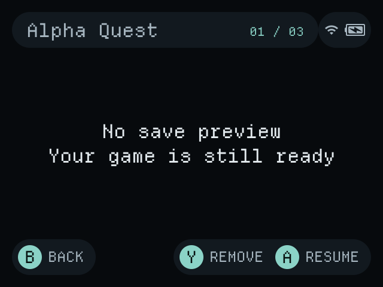

<div align="center">

# NOCTURNE

**A dark, handheld-first personal fork of NextUI for the Anbernic RG40XX H.**

[](LICENSE)
[](#hardware-focus)
[](https://github.com/LoveRetro/NextUI)

[Overview](#overview) · [Controls](#controls) · [Build](#build) · [Screenshots](#screenshots) · [Validation](#validation) · [Credits](#credits-and-license)

</div>

---

> [!IMPORTANT]
> Nocturne is a personal, source-level fork. It is not an official NextUI release, not a commercial product, and not a claim of OLED power savings. The RG40XX H has a 4-inch 640×480 IPS display; the dark theme is designed for readability and consistency on that panel. Physical-device verification is still required before treating any build as daily-driver ready.

## Overview

Nocturne keeps the parts of NextUI that make it useful on H700 hardware—MinArch, save states, quick resume, game switching, shaders, overlays, Wi-Fi/Bluetooth settings, LED control, and the existing pak layout—while reworking the frontend around a calmer dark interface and less accidental input.

The fork is named **Nocturne** because it is meant for quiet, low-light handheld play: dark surfaces, restrained accents, short transitions, and controls that stay out of the way of the game. Other candidate names were *Umbra*, *Vesper*, *Slate*, and *Lantern*; Nocturne best matched the goal without implying an OLED-specific feature.

### What changed

| Area | Nocturne behavior |
| :--- | :--- |
| Theme | Dark-only semantic palette: selection, header/footer surface, raised surface, primary text, selection text, secondary text, backdrop. Old/community colors are normalized at the config boundary. |
| Built-in palettes | Four restrained dark palettes: **Nocturne**, **Ember**, **Iris**, and **Tidal**. |
| Typography | Departure Mono by default, with a comfortable size table and font fallback. |
| Motion | Short 100 ms / 160 ms transitions, zero-duration guards, and scrolling tied to the animation setting. |
| Frontend controls | Menu tap opens Settings; Start opens Quick Menu; Menu+R1 opens the Game Switcher; Select is unassigned at the frontend level. |
| In-game shortcuts | Aggressive legacy defaults are migrated once to unassigned, except Game Switcher on Menu+R1. User-chosen nonlegacy bindings are preserved. |
| Game Switcher | Position counter, clearer title/footer, repeat navigation, two-step Y removal, missing-preview fallback, unavailable-recent handling, and a bounded three-entry preview cache. |
| H700 key monitor | Physical Menu+volume adjusts brightness; Select no longer changes color temperature. Color temperature remains in Settings → Display. |
| Personal packaging | The upstream auto-updater pak is omitted so a personal frontend does not silently replace itself with an upstream release. |

## Hardware focus

Primary target: **Anbernic RG40XX H** running Base OS with NextUI as the frontend.

- H700 Cortex-A53 CPU, Mali-G31 MP2 GPU, 1 GB RAM
- 4-inch 640×480 IPS panel, frontend scale 2
- Dual sticks, RGB banks, Wi-Fi/Bluetooth, HDMI
- Existing `h700` platform identifiers, `MinUI.zip` payload name, `.userdata` paths, recent/auto-resume files, and pak names are preserved

Other H700-family devices may work where upstream NextUI already works, but Nocturne is tuned and reviewed for the RG40XX H first.

## Controls

### Frontend

| Input | Action |
| :--- | :--- |
| D-pad | Navigate lists |
| A | Open / confirm |
| B | Back / cancel |
| X | Resume when a resumable state is highlighted |
| Menu tap | Settings; falls back to Quick Menu if Settings is unavailable |
| Start | Quick Menu |
| Menu + R1 | Game Switcher |
| L1 / R1 | Alpha jump in lists, when not used as the Menu chord |
| Select | Unassigned |
| Power | Sleep / device power behavior |

### Game Switcher

| Input | Action |
| :--- | :--- |
| Left / Right | Cycle recent games, with repeat |
| A | Resume if a state exists; otherwise open |
| Y | Arm removal; press Y again to confirm |
| B | Cancel removal, or return to the list |

Removal only removes the recent-list entry. It does not delete ROMs, battery saves, or save-state files.

### In game

| Input | Action |
| :--- | :--- |
| Menu | MinArch menu |
| Menu + R1 | Game Switcher (default) |
| Volume ± | Volume |
| Menu + Volume ± | Brightness |
| Other shortcuts | Unassigned by default; configure in MinArch |

Color temperature is adjusted from **Settings → Display**, not from a Select chord.

## Build

Nocturne uses the existing NextUI build system. A C toolchain, SDL2 development libraries, and the usual NextUI dependencies are required for desktop builds. H700 builds use the official `ghcr.io/loveretro/h700-toolchain` container.

### Host policy tests

```bash
make test-nocturne
```

These tests cover theme normalization, switcher navigation/removal policy, and the preview LRU cache.

### Desktop frontend

```bash
make build PLATFORM=desktop COMPILE_CORES=false
```

The desktop harness uses `/var/tmp/nextui/sdcard` and stub battery/network values. It is useful for layout and input checks, not for hardware timing, audio, sleep, LED, or display calibration.

### H700 components

With Docker or Podman available:

```bash
make build PLATFORM=h700 COMPILE_CORES=false
```

This builds the H700 frontend/components without rebuilding every emulator core. The H700 CI workflow also produces a component artifact for review; that artifact is not a complete installer.

### Full package

The inherited full package target remains:

```bash
make h700
```

A full package builds cores and stages the Base OS payload. It has **not** been validated end-to-end in this fork yet. The personal package omits the upstream auto-updater pak.

## Install / update

Nocturne does not publish a turnkey installer. For a fresh device, follow the upstream NextUI installation guide for Base OS + NextUI, then replace components with a Nocturne build only after reviewing the validation notes.

For an existing NextUI card:

1. Back up `.userdata`, `Roms`, `Saves`, and any custom paks/palettes.
2. Build or obtain a Nocturne H700 component bundle.
3. Replace only the corresponding frontend/component files, preserving the existing directory layout and compatibility identifiers.
4. Keep `MinUI.zip`, `.system/h700`, `Tools/h700`, and `.userdata` naming intact.
5. Boot and run the hardware checklist in [docs/VALIDATION.md](docs/VALIDATION.md).

Do not flash or overwrite a card until the physical-device checklist passes.

## Screenshots

The images below are **desktop renders from the native harness**, captured at 640×480 with a placeholder library. They are not RG40XX H device captures.

| Main list | Game Switcher |
| :---: | :---: |
|  |  |

| Quick Menu | Appearance settings |
| :---: | :---: |
|  |  |

Still needed: real RG40XX H captures of the main list, Settings, Quick Menu, Game Switcher with a real save preview, MinArch menu, sleep/wake, HDMI, and LED states.

## Validation

See [docs/VALIDATION.md](docs/VALIDATION.md) for the audit summary, build/test results, screenshot provenance, and the remaining physical RG40XX H checklist.

Current status:

- Host policy tests pass
- Native desktop frontend/component build passes
- H700 cross-builds pass for the changed frontend/components and supporting apps
- Full H700 package/core rebuild and physical-device behavior remain unverified

## Limitations

- No physical RG40XX H verification has been performed in this workspace.
- Desktop screenshots use placeholder library entries and stub hardware state.
- Full installer packaging, core rebuilds, HDMI, sleep/wake, audio, LED, Wi-Fi/Bluetooth, and battery behavior need device testing.
- The theme normalizes legacy colors to keep the UI dark; it does not preserve arbitrary light community palettes.
- The upstream auto-updater is intentionally omitted from personal packages.

## Credits and license

Nocturne is a personal fork of [NextUI](https://github.com/LoveRetro/NextUI), which is itself a fork of [MinUI](https://github.com/shauninman/MinUI) by Shaun Inman. Upstream authors, contributors, licenses, and notices are preserved in [LICENSE](LICENSE) and [NOTICE](NOTICE).

This project is licensed under **PolyForm Noncommercial 1.0.0**. Personal, educational, and non-commercial use is permitted; commercial use is not. See [LICENSE](LICENSE) and [NOTICE](NOTICE) for the full terms and license-transition history.
