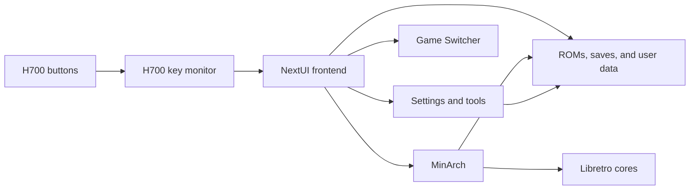

<div align="center">

# Nocturne

A NextUI fork for the Anbernic RG40XX H that provides an H700 frontend, MinArch integration, and configurable controls.

[](https://github.com/NadimHider/nocturne/stargazers)
[](https://github.com/NadimHider/nocturne/releases/latest)
[](LICENSE)
[](workspace/)

[Documentation](docs/VALIDATION.md) &#183; [Report Bug](https://github.com/NadimHider/nocturne/issues/new?title=Bug%3A%20) &#183; [Request Feature](https://github.com/NadimHider/nocturne/issues/new?title=Feature%3A%20)

</div>

## Features

| Component | Capability |
| --- | --- |
| Frontend | Dark palettes, Departure Mono, list navigation, and configurable transitions |
| Controls | Menu opens Settings, Start opens Quick Menu, and Menu + R1 opens Game Switcher |
| Game Switcher | Recent-game navigation, resume, confirmed removal, and a three-entry preview cache |
| MinArch | Libretro game execution, save states, shaders, and configurable shortcuts |
| Settings | Display, palette, font, Wi-Fi, Bluetooth, and device options |
| H700 | RG40XX H input, brightness, LED control, and existing NextUI pak paths |

## Architecture



Shared UI, theme, and configuration code is in `workspace/all/common`; platform code is in `workspace/h700`; card resources are in `skeleton`.

## Quickstart

The H700 release archive updates an existing Base OS and NextUI card. It is a component bundle, not a bootable image or a complete installer. Back up ROMs, saves, `.userdata`, and custom paks before updating. Hardware validation is required.

On a Linux host with GitHub CLI and `unzip` installed:

```sh
gh release download v1.0.0 --repo NadimHider/nocturne --pattern 'Nocturne-v1.0.0-H700-components.zip'
read -r -p 'Mounted SD card directory: ' SDCARD
test -d "$SDCARD/.system/h700" && test -d "$SDCARD/Tools/h700" || { echo 'NextUI installation not found'; exit 1; }
unzip -o Nocturne-v1.0.0-H700-components.zip -d "$SDCARD"
sync
```

Eject the card, insert it into the RG40XX H, and power on. Confirm the frontend, Settings, game launch, saves, and controls using the [device checklist](docs/VALIDATION.md).

<details>
<summary>Build H700 components from source</summary>

Install Git, GNU Make, and Docker or Podman on a Linux host, then run:

```sh
git clone https://github.com/NadimHider/nocturne.git
cd nocturne
make setup
make build PLATFORM=h700 COMPILE_CORES=false
```

The build uses `ghcr.io/loveretro/h700-toolchain:latest`. Outputs are written under `workspace/*/build/h700` and `workspace/h700/keymon`; this command does not create the release archive.

</details>

<details>
<summary>Run host policy tests</summary>

Install a C compiler, GNU Make, Bash, pkg-config, SDL2, and SDL2_image development packages, then run:

```sh
make test-nocturne
```

The tests cover theme normalization, switcher policy, and preview cache behavior.

</details>

## Configuration

| Parameter | Type | Default | Description |
| --- | --- | --- | --- |
| `PLATFORM` | Make variable | Required for builds | Target platform, such as `h700` or `desktop` |
| `COMPILE_CORES` | Make variable | Unset | Set to `false` or `0` to skip emulator core compilation |
| `CONTAINER_RUNTIME` | Make variable | Docker, then Podman | Container runtime used by the cross-build |
| `CONTAINER_MOUNT_OPTS` | Make variable | Empty | Additional container mount options |
| Font | Device setting | Departure Mono, comfortable size | Frontend font and size |
| Menu animations | Device setting | Enabled | Controls frontend menu animations |
| In-game shortcuts | Device setting | Game Switcher on Menu + R1 | Other legacy defaults migrate to unassigned; custom bindings are retained |

<details>
<summary>Controls</summary>

| Input | Action |
| --- | --- |
| D-pad, A, B | Navigate, confirm, or go back |
| Menu | Open Settings, or Quick Menu if Settings is unavailable |
| Start | Open Quick Menu |
| Menu + R1 | Open Game Switcher |
| Menu + volume | Adjust brightness |
| Game Switcher Y twice | Remove the selected recent entry without deleting its ROM or saves |

</details>

<details>
<summary>Troubleshooting</summary>

- If the device does not boot, check that the Base OS and NextUI installation is functional and that `.system/h700` is at the SD card root.
- If a game does not launch, check its emulator pak, core, and BIOS requirements.
- If a cross-build cannot start, check that Docker or Podman is available and can pull the H700 toolchain image.
- The release bundle does not replace emulator cores, ROMs, saves, or user configuration.

</details>

## Star history

[](https://star-history.com/#NadimHider/nocturne&Date)

[PolyForm Noncommercial 1.0.0](LICENSE) &#183; [Contributing](CONTRIBUTING.md) &#183; Based on [NextUI](https://github.com/LoveRetro/NextUI)
