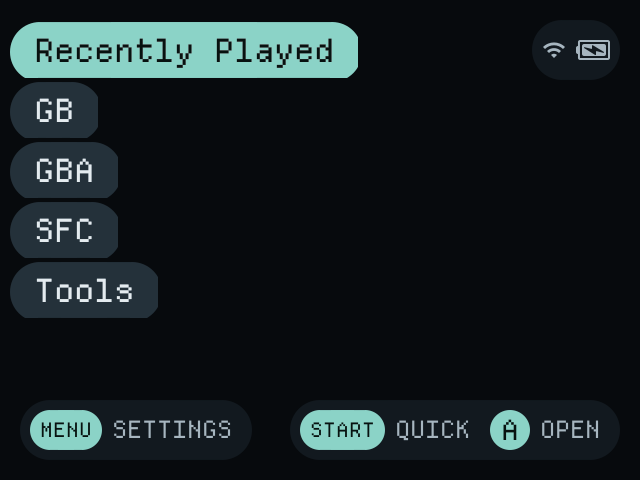
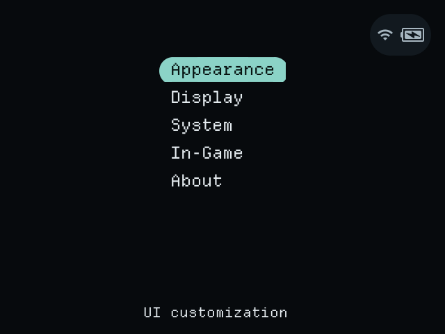
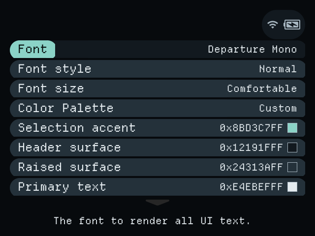
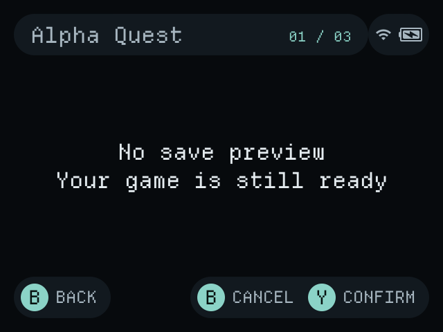

<div align="center">

# Nocturne

A dark, handheld-first NextUI distribution for the Anbernic RG40XX H.

[](https://github.com/NadimHider/nocturne/releases/latest)
[](LICENSE)
[](docs/ARCHITECTURE.md)
[](https://github.com/NadimHider/nocturne/actions/workflows/h700.yaml)

[Install](docs/INSTALL.md) | [Controls](docs/CONTROLS.md) | [Configuration](docs/CONFIGURATION.md) | [Architecture](docs/ARCHITECTURE.md) | [Validation](docs/VALIDATION.md)

</div>



## Overview

Nocturne is a maintained fork of [NextUI](https://github.com/LoveRetro/NextUI) for the Anbernic RG40XX H. NextUI is itself a fork of [MinUI](https://github.com/shauninman/MinUI) by Shaun Inman. Nocturne preserves the upstream pak format, card layout, and libretro integration, and adds a dark visual system, tuned typography, time-based motion, and H700-specific defaults.

The frontend opens directly on the game-system list. There is no dashboard, launcher, or separate home screen. The library is the first screen.

This repository is the official source for Nocturne builds, documentation, and release artifacts. Nocturne is an independent project and is not published, endorsed, or supported by the NextUI team or the original MinUI author. See [NOTICE](NOTICE) for lineage and licensing.

## At a glance

| | |
| --- | --- |
| Device | Anbernic RG40XX H (Allwinner H700) |
| Display | 640 x 480, 4:3 |
| Frontend | NextUI-derived C frontend |
| Emulation | MinArch with libretro cores |
| Palettes | 10 built-in dark palettes, custom palette support |
| Typography | Departure Mono, four size steps, normal and bold styles |
| Boot | Departure Mono wordmark drawn by the H700 boot shim |
| Motion | 60 fps selection glide, snappy and comfortable transitions |
| Storage | Base OS card layout with root-level `.system`, `Tools`, and `Roms` |
| License | PolyForm Noncommercial 1.0.0 |

## Features

### Frontend

- Boots to the game-system list by default. Persisted `defaultView` values are clamped to a valid view.
- Ten built-in dark palettes: Nocturne, Ember, Iris, Tidal, Obsidian Gold, Midnight Sapphire, Aurora Pine, Crimson Noir, Graphite Copper, and Velvet Indigo.
- Custom palette files in `.system/res/palettes` are normalized for dark surfaces and readable text contrast.
- Departure Mono is the default font. Settings provides four size steps and a normal or bold style.
- The boot shim draws the Nocturne wordmark in Departure Mono on every boot, before the card is mounted.
- The font menu lists only the fonts installed in `.system/res`. The stock build ships Departure Mono, Silkscreen, Home Video, and Fake Receipt.
- Selection pills are drawn from the native rounded asset at the requested height, with centered text and no cropped end caps.
- Selection glide and screen transitions are driven by elapsed time at 60 fps, with snappy and comfortable modes.
- Recent games, collections, game art, folder names, the clock, battery percentage, and thumbnail radius are configurable.

### Game Switcher

- Opens from the frontend, Quick Menu, or Settings with Menu + R1.
- Shows a position counter and a preview of the selected recent game.
- Keeps a three-entry preview cache on the main thread.
- Resumes the selected game with A.
- Removes a recent entry with Y, Y. Removal affects only the recent list and does not delete ROMs or saves.
- Handles missing previews and unavailable games without leaving the switcher.

### Controls and settings

- Menu opens Settings, with Quick Menu as a fallback when Settings is unavailable.
- Start opens Quick Menu.
- Menu + R1 opens Game Switcher.
- Menu + volume adjusts brightness.
- Settings covers appearance, display, system, in-game behavior, network, Bluetooth, and device information.
- Wi-Fi, Bluetooth, time zone, NTP, screen and suspend timeouts, save formats, and haptics are available in the Settings app.

### MinArch

- Runs libretro cores with the standard NextUI pak interface.
- Supports save states, auto-resume, quicksave, screenshots, fast-forward, rewind, shaders, cheats, control remaps, and RetroAchievements.
- In-game shortcuts are intentionally conservative. Game Switcher is bound to Menu + R1 by default; other actions can be assigned in the MinArch menu under Options, Shortcuts.

### H700 integration

- Native H700 key monitor for volume and Menu + volume brightness handling.
- Frontend handling for Menu, Start, and Menu + R1.
- LED control through the LedControl pak.
- HDMI output, sleep and wake, battery reporting, and power-off handling through the H700 platform layer.
- Existing NextUI pak paths and compatibility identifiers are preserved.

### Maintenance

- CleanRomset consolidates legacy ROM folders and removes non-ROM clutter.
- `organize_sdcard.py` performs the same cleanup from a Windows PC.
- Host policy tests cover theme normalization, switcher behavior, and preview caching.
- GitHub Actions builds the H700 component bundle and runs the full core matrix.

## Screenshots

| Game library | Game Switcher |
|:---:|:---:|
|  |  |
| The game-system list is the default view. | Recent games, position counter, and resume or remove actions. |

| Settings | Appearance |
|:---:|:---:|
|  |  |
| Settings is available from Menu or the Tools folder. | Font, palette, semantic colors, and interface options. |

| Removal confirmation | |
|:---:|:---:|
|  | |
| Removing a recent entry requires a second confirmation. | |

## Requirements

- Anbernic RG40XX H with an Allwinner H700 SoC.
- A working Base OS and NextUI installation on the SD card.
- A card reader and a backup of `.userdata`, `Saves`, `Roms`, and any custom paks.
- An exFAT-formatted SD card. The tested card uses the exFAT label `Roms`.

Nocturne is distributed as a component bundle. It updates an existing card and does not create a bootable card by itself. It does not include a bootloader, kernel, Base OS, emulator cores, BIOS files, or ROMs.

## Card layout

The system folders must be at the root of the SD card. Placing `.system` or `Tools` inside `Roms` prevents the frontend from finding its binaries and paks.

```text
SD card root
|-- .system
|-- .userdata
|-- Bios
|-- Cheats
|-- Emus
|-- Roms
|-- Saves
|-- Shaders
`-- Tools
```

## Installation

> [!IMPORTANT]
> Back up the card before updating. The release archive overwrites frontend binaries, palette files, and tool paks. It does not touch ROMs, saves, or user settings unless those files are present in the archive.

### Update an existing card

1. Download the latest release archive from the [releases page](https://github.com/NadimHider/nocturne/releases/latest).
2. Extract the archive to the root of the SD card, replacing existing files.
3. Flush the card and eject it safely.
4. Insert the card into the RG40XX H and power on.
5. Confirm the frontend opens on the game-system list and that a game launches.

On Linux or macOS with the GitHub CLI:

```sh
gh release download v1.0.2 --repo NadimHider/nocturne \
  --pattern 'Nocturne-v1.0.2-H700-components.zip'
unzip -o Nocturne-v1.0.2-H700-components.zip -d /path/to/card
sync
```

On Windows with PowerShell, replace `H:` with the card's drive letter:

```powershell
gh release download v1.0.2 --repo NadimHider/nocturne --pattern 'Nocturne-v1.0.2-H700-components.zip'
Expand-Archive .\Nocturne-v1.0.2-H700-components.zip -DestinationPath H:\ -Force
```

The archive contains:

| Path | Contents |
| --- | --- |
| `.system/h700/bin/` | `nextui.elf`, `minarch.elf`, `keymon.elf`, `nextval.elf`, and `syncsettings.elf` |
| `.system/h700/dat/` | `dmenu.bin`, the boot shim and Departure Mono boot splash payload |
| `.system/res/palettes/` | Ten built-in palette files |
| `Tools/h700/Settings.pak/` | Settings application |
| `Tools/h700/LedControl.pak/` | LED control application |
| `Tools/h700/CleanRomset.pak/` | ROM folder cleanup tool |
| `.system/version.txt` | Release and build stamp |

### Fresh installation

1. Install Base OS and NextUI on the SD card using the upstream instructions.
2. Boot the device once and confirm that the stock frontend starts.
3. Apply the Nocturne archive to the card root.
4. Add ROMs, BIOS files, and cores as needed.
5. Boot the device and complete the checks in [Validation](docs/VALIDATION.md).

Detailed procedures, rollback steps, and troubleshooting are in [docs/INSTALL.md](docs/INSTALL.md).

## Controls

### Frontend

| Input | Action |
| --- | --- |
| D-pad | Move the selection |
| A | Open the selected item |
| B | Go back |
| Menu | Open Settings, or Quick Menu if Settings is unavailable |
| Start | Open Quick Menu |
| Menu + R1 | Open Game Switcher |
| Menu + Volume | Adjust brightness |
| Power | Sleep |

### Game Switcher

| Input | Action |
| --- | --- |
| Left / Right | Previous or next recent game |
| A | Resume the selected game |
| Y, Y | Remove the selected entry from the recent list |
| B | Cancel or go back |

### In game

| Input | Action |
| --- | --- |
| Menu | Open the MinArch menu |
| Menu + R1 | Open Game Switcher |
| Options, Shortcuts | Bind save state, load state, save and quit, fast-forward, rewind, screenshots, reset, and other actions |

The full control reference, including Quick Menu behavior and shortcut migration, is in [docs/CONTROLS.md](docs/CONTROLS.md).

## Configuration

Nocturne stores frontend settings in `.userdata/shared/minuisettings.txt`. The Settings app writes this file; manual edits should be made with the frontend closed.

| Key | Values | Default |
| --- | --- | --- |
| `palette` | Palette name | `Nocturne` |
| `defaultView` | `0` game list, `1` Game Switcher, `2` Quick Menu | `0` |
| `font` | Font filename in `.system/res` | `DepartureMono-Regular.otf` |
| `fontStyle` | `0` normal, `1` bold | `0` |
| `fontSize` | `0` Compact, `1` Comfortable, `2` Large, `3` Extra Large | `1` |
| `menuanim` | `0` off, `1` on | `1` |
| `menutransitions` | `0` off, `1` snappy, `2` comfortable | `1` |
| `recents` | `0` hidden, `1` shown | `1` |
| `collections` | `0` hidden, `1` shown | `1` |
| `gameart` | `0` hidden, `1` shown | `1` |
| `tools` | `0` hidden, `1` shown | `1` |
| `showclock` | `0` hidden, `1` shown | `0` |
| `batteryperc` | `0` hidden, `1` shown | `0` |
| `wifi` | `0` off, `1` on | `0` |
| `bluetooth` | `0` off, `1` on | `0` |

### Game art

The frontend reads one image per game from `<system>/.media/<rom-name>.png`, where `<rom-name>` is the ROM filename without its extension. For example, `Roms/Super Nintendo Entertainment System (SFC)/Soul Blazer (U) [!].sfc` uses `Roms/Super Nintendo Entertainment System (SFC)/.media/Soul Blazer (U) [!].png`.

Game art is card data and is not included in the release archive. The frontend does not match JPG files or `-image` suffixes. Convert or rename art to the exact PNG path above.

<details>
<summary>Built-in palettes</summary>

| Palette | Character |
| --- | --- |
| Nocturne | Neutral dark surfaces with a cool selection accent |
| Ember | Warm ember accent on near-black brown surfaces |
| Iris | Violet accent on deep indigo surfaces |
| Tidal | Teal accent on blue-green surfaces |
| Obsidian Gold | Gold accent on warm graphite surfaces |
| Midnight Sapphire | Sapphire accent on deep navy surfaces |
| Aurora Pine | Mint accent on dark pine surfaces |
| Crimson Noir | Rose accent on oxblood surfaces |
| Graphite Copper | Copper accent on neutral graphite surfaces |
| Velvet Indigo | Lavender accent on dark indigo surfaces |

</details>

<details>
<summary>Custom palette format</summary>

Palette files live in `.system/res/palettes` and use seven semantic color slots:

```ini
version=1
name=Obsidian Gold
color1=0xD8B36AFF
color2=0x14130FFF
color3=0x2A261CFF
color4=0xF2ECDFFF
color5=0x120E06FF
color6=0xC2B48FFF
color7=0x080705FF
```

| Slot | Role |
| --- | --- |
| `color1` | Selection fill |
| `color2` | Header and footer surface |
| `color3` | Raised surface |
| `color4` | Primary text |
| `color5` | Text on the selection |
| `color6` | Secondary text and hints |
| `color7` | Backdrop |

Imported colors are normalized for dark surfaces and text contrast. The original palette file is not rewritten.

</details>

Configuration details, font installation, motion settings, and shortcut migration are in [docs/CONFIGURATION.md](docs/CONFIGURATION.md).

## Build from source

### Host policy tests

Install a C compiler, GNU Make, Bash, pkg-config, SDL2, and SDL2_image development packages, then run:

```sh
make test-nocturne
```

The tests cover theme normalization, switcher navigation and removal policy, and preview cache promotion and eviction.

### H700 components

On Ubuntu or Debian, install Git, GNU Make, and Docker:

```sh
sudo apt-get update
sudo apt-get install -y git make docker.io
sudo systemctl enable --now docker
```

Build the H700 components:

```sh
git clone https://github.com/NadimHider/nocturne.git
cd nocturne
make setup
make build PLATFORM=h700 COMPILE_CORES=false
```

Docker must be usable by the current user. The build uses `ghcr.io/loveretro/h700-toolchain:latest`. Build outputs land in `workspace/*/build/h700`, and the key monitor is built in `workspace/h700/keymon`.

### Continuous integration

| Workflow | Purpose |
| --- | --- |
| [H700 build](https://github.com/NadimHider/nocturne/actions/workflows/h700.yaml) | Cross-builds the H700 components and packages the update archive |
| [CI](https://github.com/NadimHider/nocturne/actions/workflows/ci.yaml) | Builds the full core matrix and the aggregate release package |
| [Development](https://github.com/NadimHider/nocturne/actions/workflows/dev.yaml) | Desktop and development builds |

## Project layout

```text
workspace/
  all/
    common/      Shared UI, theme, configuration, video, and input code
    nextui/      Frontend
    minarch/     Libretro launcher
    settings/    Settings application
  h700/          H700 platform layer, key monitor, and packaging
skeleton/
  BASE/          Card skeleton and base assets
  SYSTEM/        .system resources, fonts, and palettes
  EXTRAS/        Optional paks and tools
docs/            Installation, controls, configuration, architecture, validation
.github/         CI and H700 packaging workflows
```

The component boundaries, runtime flow, and build pipeline are described in [docs/ARCHITECTURE.md](docs/ARCHITECTURE.md).

## Validation

Nocturne v1.0.2 was built from commit `c2a09365`. The H700 workflow passed in [run 41175554962](https://github.com/NadimHider/nocturne/actions/runs/41175554962), and the full CI matrix passed in [run 41175554920](https://github.com/NadimHider/nocturne/actions/runs/41175554920). The release binaries are aarch64 and retain the same shared-library dependencies as the previous build.

Hardware checks on the RG40XX H cover the Departure Mono boot splash, the default game-system list, pill geometry, typography, selection and transition motion, the four installed fonts, font persistence, the absence of Pak Store, game art lookup, and game launch. The complete checklist, binary hashes, and archive digest are in [docs/VALIDATION.md](docs/VALIDATION.md).

## Troubleshooting

| Symptom | Check |
| --- | --- |
| Device does not boot | Base OS and NextUI are intact, and `.system/h700` is at the card root |
| Game does not launch | The emulator pak, libretro core, and BIOS files are present |
| Settings does not open | `Tools/h700/Settings.pak` exists and the pak is executable |
| Frontend shows a blank screen after an update | Restore the previous `.system/h700/bin/` files from backup |
| Card is not recognized | The card is exFAT, inserted correctly, and was ejected safely |
| Build cannot start | Docker or Podman is available and can pull the H700 toolchain image |

More troubleshooting steps are in [docs/INSTALL.md](docs/INSTALL.md).

## Contributing

Bug reports and pull requests are welcome. Read [CONTRIBUTING.md](CONTRIBUTING.md) before opening a pull request. Changes should preserve upstream pak compatibility, card paths, and license notices.

## License and credits

Nocturne is distributed under the [PolyForm Noncommercial 1.0.0](LICENSE). The project preserves the upstream MinUI and NextUI notices and compatibility identifiers. See [NOTICE](NOTICE) for the full lineage and license transition.

- MinUI by Shaun Inman: https://github.com/shauninman/MinUI
- NextUI by the NextUI team: https://github.com/LoveRetro/NextUI
- Nocturne maintained by Nadim Hider: https://github.com/NadimHider/nocturne
