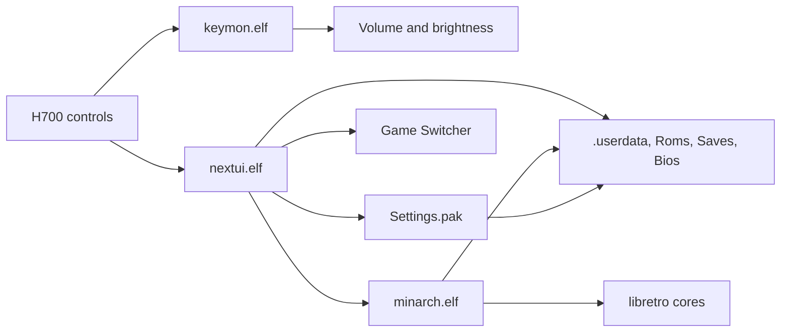

# Architecture

Nocturne is a NextUI-derived frontend distribution for the Anbernic RG40XX H. It keeps the upstream runtime model and pak format, and changes the visual system, typography, motion, and H700 defaults.

## Lineage

| Project | Role |
| --- | --- |
| [MinUI](https://github.com/shauninman/MinUI) | Original minimal handheld frontend by Shaun Inman |
| [NextUI](https://github.com/LoveRetro/NextUI) | Community fork of MinUI with paks, settings, cores, and broader device support |
| Nocturne | H700-focused fork of NextUI maintained by Nadim Hider |

Nocturne preserves upstream compatibility identifiers, card paths, pak conventions, and license notices. It is an independent project and is not published, endorsed, or supported by the NextUI team or the original MinUI author. See [NOTICE](../NOTICE).

## Runtime components



| Component | Responsibility |
| --- | --- |
| `keymon.elf` | Handles H700 volume keys and Menu + volume brightness adjustment |
| `nextui.elf` | Game-system list, navigation, palettes, typography, motion, Quick Menu, and Game Switcher |
| `minarch.elf` | Loads libretro cores, manages save states, shaders, cheats, remaps, and in-game shortcuts |
| `Settings.pak` | Appearance, display, system, in-game, network, Bluetooth, and device settings |
| `LedControl.pak` | RGB LED configuration |
| `CleanRomset.pak` | Consolidates legacy ROM folders and removes non-ROM files |
| `syncsettings.elf`, `nextval.elf` | Supporting utilities for settings synchronization and value editing |

## Repository layout

```text
workspace/
  all/
    common/      Shared UI, theme, configuration, video, input, HTTP, and utilities
    nextui/      Frontend
    minarch/     Libretro launcher
    settings/    Settings application
    ledcontrol/  LED control application
    clock/       Clock application
  h700/          H700 platform layer, key monitor, packaging, and device support
skeleton/
  BASE/          Card skeleton and base assets
  SYSTEM/        .system resources, fonts, palettes, and platform files
  EXTRAS/        Optional emulator paks and tools
docs/            Installation, controls, configuration, architecture, validation
.github/         CI and H700 packaging workflows
```

The shared layer under `workspace/all/common` contains the palette engine, font loading, surface animation helpers, configuration parser, and platform abstraction. Platform-specific behavior lives under `workspace/h700`.

## Boot and runtime flow

1. Base OS mounts the SD card and starts the H700 launcher.
2. The launcher starts the H700 helper processes, including `keymon.elf`, `batmon.elf`, and `audiomon.elf`, then starts `nextui.elf` from `.system/h700/bin`.
3. The frontend loads `.userdata/shared/minuisettings.txt`, applies the saved palette and font, and opens the configured startup view.
4. The frontend scans the card for game-system folders and reads the selected directory.
5. Launching a game starts `minarch.elf` with the matching pak and libretro core.
6. Exiting a game returns to the frontend and updates the recent list.

Nocturne defaults `defaultView` to the game-system list. The frontend clamps persisted values to a valid view when it starts, so an invalid or outdated setting cannot leave the device on an empty screen.

## Theme and typography

The palette engine exposes seven semantic slots:

| Slot | Role |
| --- | --- |
| `color1` | Selection fill |
| `color2` | Header and footer surface |
| `color3` | Raised surface |
| `color4` | Primary text |
| `color5` | Text on the selection |
| `color6` | Secondary text and hints |
| `color7` | Backdrop |

Selection text is derived from the selection fill. Imported palettes are normalized for dark opaque surfaces and lifted text contrast, and the original palette file is not rewritten.

Fonts are loaded from `.system/res` through SDL_ttf. The default is Departure Mono. Four size steps map to the frontend and list text, with a floor of 8 points for the smallest text. Missing fonts fall back to Departure Mono.

## Motion

Selection glide and screen transitions are time-based. The selection worker runs eight eased frames at 60 fps and measures each frame from the start of the callback, sleeping only the remaining part of the 16.67 ms budget. This keeps motion consistent when presenting a frame takes longer than expected.

Screen transitions use elapsed wall-clock time and 60 fps frame pacing. Snappy transitions run for 100 ms, comfortable transitions for 160 ms. The animation setting also controls title scrolling.

## Build pipeline

| Workflow | Runner | Output |
| --- | --- | --- |
| `h700.yaml` | `ubuntu-24.04-arm` | Cross-builds the H700 components and packages `h700-update` |
| `ci.yaml` | `ubuntu-24.04-arm` | Builds the full core matrix and aggregate release package |
| `dev.yaml` | Hosted runner | Desktop and development builds |

Local H700 builds use the `ghcr.io/loveretro/h700-toolchain:latest` container:

```sh
make setup
make build PLATFORM=h700 COMPILE_CORES=false
```

Host policy tests run without the cross toolchain:

```sh
make test-nocturne
```

The H700 packaging step collects the frontend, MinArch, key monitor, supporting utilities, Settings, LED Control, and CleanRomset into a single update archive. Release packaging arranges the binaries under `.system/h700/bin`, the tools under `Tools/h700`, adds the built-in palettes under `.system/res/palettes`, and writes `.system/version.txt` with the release and build stamp.

## Compatibility

Nocturne preserves the following NextUI interfaces:

- Pak folders with a `launch.sh` entry point
- `.system/h700/bin`, `.system/h700/paks`, and `.system/h700/cores` paths
- `.userdata` configuration, save, state, and log paths
- `minuisettings.txt` key names and value formats
- Save and state format settings
- Emulator pak tags and ROM folder naming
- PolyForm Noncommercial 1.0.0 licensing and upstream notices

Changes that would break these interfaces are out of scope for a point release.

## Design constraints

- Panel: 640 x 480, 4:3, 4-inch class display.
- Target frame rate: 60 fps for frontend motion.
- Storage: exFAT SD card with root-level system directories.
- Runtime: frontend, key monitor, battery monitor, audio monitor, and the launched game.
- Memory: preview caching is bounded to three entries.
- Input: H700 buttons, volume keys, power, and optional USB or Bluetooth controllers.

## Release process

1. Build the H700 components from the target commit through `h700.yaml`.
2. Run the full CI matrix through `ci.yaml`.
3. Verify the installed binaries are aarch64 and retain their shared-library dependencies.
4. Check the card layout, palettes, settings, and boot-critical files.
5. Flush the card and run a file system check before ejecting.
6. Boot the device and complete the validation checklist.
7. Publish the release asset with the build commit, workflow runs, and SHA256.

The current validation record is in [VALIDATION.md](VALIDATION.md).
